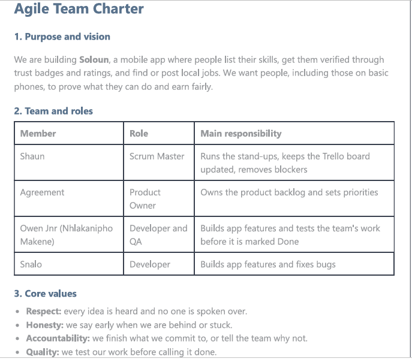
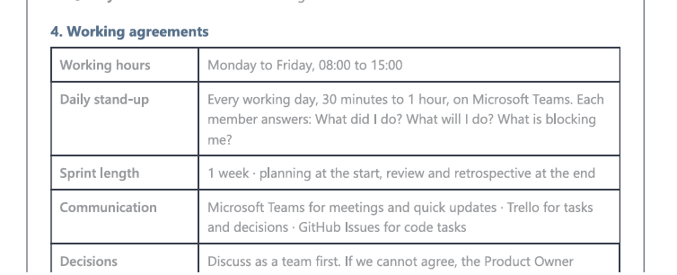
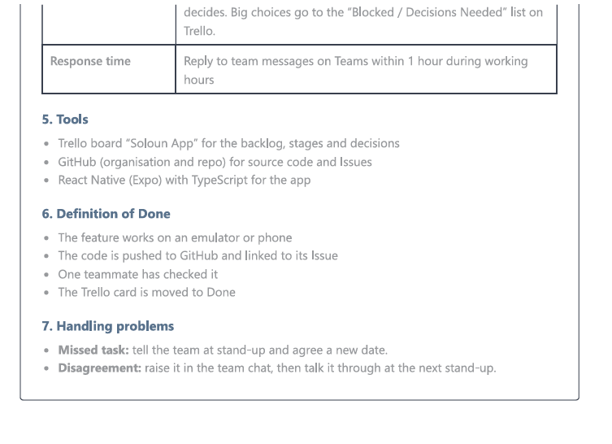
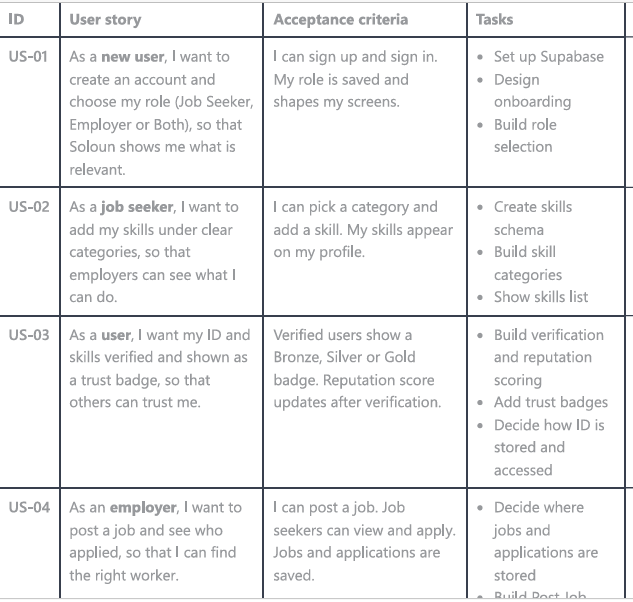
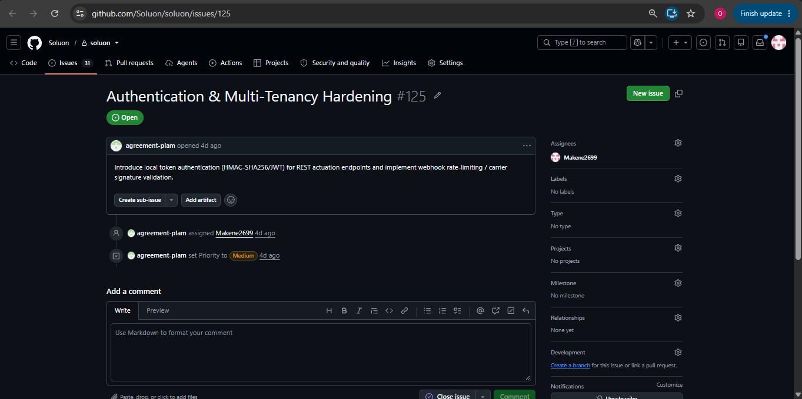
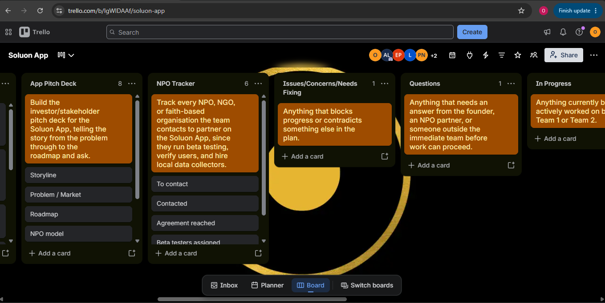
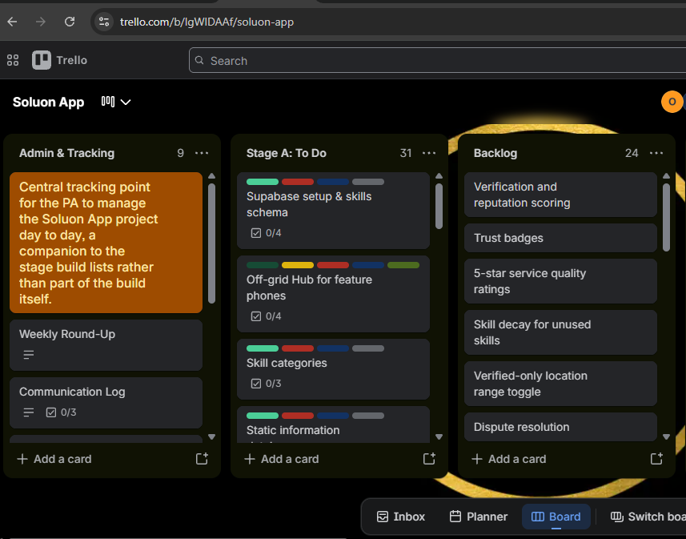

# 💼 Nhlakanipho Makene

##  Contact Information
- 📞 Phone: 0685048220
- 📧 Email: 223219665@mycput.ac.za
- 📍 Location: Cape Town, Salt River
- 🌐 GitHub: https://github.com/Makene2699

---

##  Professional Overview
Third-year ICT Application Development student with a strong foundation in software development and problem-solving. Skilled in programming, database management, and developing applications using modern technologies. Passionate about building efficient software solutions and continuously learning new technologies. Seeking opportunities to apply my skills in a professional IT environment.

---

##  Education
**Cape Peninsula University of Technology**
- Higher Certificate in ICT (2023–2024)
- Diploma in ICT Applications Development *(Expected: Jan 2027)*

---
## Technical Skills
- Database  
- Java  
- SQL  
- Python  
- Data Structures  
- JavaScript  
- Algorithms  

---

##  Projects

###  Admission Tracking System
**Technologies Used:**
- Java  
- MySQL  
- NetBeans  
- Object-Oriented Programming  

Designed and developed a system that allows users to track admission applications in real time. Users can view updates, explore job opportunities, and submit applications.

---

###  Community Clean-Up Platform
**Technologies Used:**  
-  HTML/CSS, JavaScript

Developed a Java-based platform that allows users to report dirty areas, organize clean-up events, and volunteer.

Focused on improving community engagement and environmental awareness.

---

##  Extracurricular Activities
- Successfully led a team in the design and development of a creative application for Project 2, demonstrating leadership, collaboration, and problem-solving skills. Played a key role in improving the application’s user interface and overall usability by implementing user-centered design principles, resulting in a more intuitive and efficient user experience. Additionally, coordinated team efforts, ensured timely project completion, and maintained clear communication throughout the development process.

---
## Mock Interview Video

https://github.com/Makene2699/makene2699.github.io/releases/download/v1.0/WhatsApp.Video.2026-06-23.at.10.32.30.mp4

---

## REFERENCES
  SIhle Lawrence 071 540 5348

##  Reflection: Coding My CV Using Markdown (STAR Method)

### Situation  
For this assignment, I was required to create my CV using GitHub Flavoured Markdown instead of traditional tools like Microsoft Word. This was a new experience for me because I had to think in terms of code and structure rather than using visual formatting tools. It helped me understand how developers present information in a clean and structured way.

### Task  
My task was to convert my CV into a professional Markdown document that would display correctly on GitHub. The CV needed to include all important sections such as personal details, education, technical skills, and projects, while remaining easy to read and well-organised.

### Action  
I started by planning the structure of my CV and deciding the order of sections. I then learned how to use Markdown features such as headings, bullet points, bold text, and links. While working on the README.md file, I continuously checked the preview on GitHub to fix formatting issues like spacing and alignment. I also improved my project descriptions to clearly show the technologies I used and my role in each project.

### Result  
In the end, I produced a clean and professional CV that displays correctly on GitHub. This task improved my ability to write technical documents and pay attention to detail. I also became more confident using Markdown and GitHub, which are important tools in the software development industry. Now I have a CV that I can easily share online with potential employers.

---

##  Reflection: Mock Interview Video (STAR Method)

### Situation  
As part of my portfolio, I had to complete a mock interview and include the video in my GitHub Pages website. This was important because it allowed me to practice how to present myself in a professional interview setting.

### Task  
My task was to prepare for the interview, record a clear and professional video, and make sure it could be accessed through my portfolio. The video needed to show good communication skills and confidence.

### Action  
I prepared by practicing common interview questions and thinking about how to answer them clearly. When recording the video, I made sure I was in a quiet environment with good lighting. After recording, I uploaded the video to Google Drive and made it accessible using a public link. I then added the link and embedded it into my README file so it could be viewed from my portfolio.

### Result  
I was able to successfully include my interview video in my portfolio. This experience helped me improve my confidence, communication, and presentation skills. I also learned how to manage and share media content online. Now I feel more prepared for real job interviews and more comfortable presenting myself professionally.

---

##  Reflection: Using GitHub Pages (STAR Method)

### Situation  
For this assignment, I needed to publish my digital portfolio online using GitHub Pages. Before this, I had only used GitHub to store code and had no experience with deploying a website.

### Task  
My task was to create a repository, organise my portfolio content, and configure GitHub Pages so that my work could be viewed as a live website. I also needed to make sure that all content, including my CV and video, worked properly online.

### Action  
I created my repository and added my README.md file with all my portfolio content. I then went to the repository settings and enabled GitHub Pages using the main branch. After deployment, I tested the website to check if everything was displaying correctly. When I found issues, such as formatting or links not working, I corrected them and updated the repository.

### Result  
I successfully published my portfolio and received a live website link. This gave me a better understanding of how websites are deployed and how GitHub can be used beyond just coding. I now have an online portfolio that I can share with lecturers and potential employers. This experience also improved my problem-solving skills and confidence in using GitHub tools.

---
 
# 🚀 Agile Project: Soloun (Project Presentation 3)
 
**Project:** Soloun, a mobile job marketplace built with React Native (Expo) and TypeScript.
It connects **job seekers** and **employers**, lets users list and verify skills, earn trust badges (Bronze, Silver, Gold), post and apply for jobs, and find nearby vendors.
 
**My role:** Developer and QA (Owen Jnr, Nhlakanipho Makene)
**Team members:** Shaun (Scrum Master), Agreement (Product Owner), Snalo (Developer), Owen Jnr (Developer and QA)
 
---
 
## 1. Agile Team Charter
 
### Evidence

 
| Item | Our Agreement |
|------|---------------|
| **Purpose** | Build Soloun, a mobile app where people list their skills, get them verified through trust badges and ratings, and find or post local jobs. |
| **Core values** | Respect, honesty, accountability, quality |
| **Roles** | Shaun: Scrum Master · Agreement: Product Owner · Owen Jnr: Developer and QA · Snalo: Developer |
| **Working hours** | Monday to Friday, 08:00 to 15:00 |
| **Daily stand-up** | Every working day, 30 minutes to 1 hour, on Microsoft Teams. Each member says what they did, what they will do, and what blocks them. |
| **Sprint length** | 1 week: planning at the start, review and retrospective at the end |
| **Communication** | Microsoft Teams for meetings and quick updates · Trello for tasks and decisions · GitHub Issues for code tasks |
| **Response time** | Reply to team messages on Teams within 1 hour during working hours |
| **Decisions** | Team discusses first; if we cannot agree, the Product Owner decides. Big choices go to the "Blocked / Decisions Needed" list on Trello. |
| **Definition of Done** | Feature works on an emulator or phone, code is pushed to GitHub and linked to its Issue, one teammate has checked it, and the Trello card is moved to Done |
| **Handling problems** | Missed task: tell the team at stand-up and agree a new date. Disagreement: raise it in the team chat, then talk it through at the next stand-up. |
 
### Reflection (STAR)
**Situation:** Before writing any code, our team of four had to agree on how we would work together. In earlier group work, tasks were unclear and some members did not know what was expected of them.
 
**Task:** Create a team charter that defined our purpose, values, roles, and working rules so that everyone was aligned from day one.
 
**Action:** We agreed on roles (Shaun as Scrum Master, Agreement as Product Owner, and two developers), our working hours of 08:00 to 15:00, daily Teams stand-ups, a one-hour reply time, and a Definition of Done. I wrote these into the charter. 
 
**Result:** The charter reduced confusion and gave us something to refer back to when work slipped. I learned that Agile depends on trust and shared agreements, not only on tools. 
 
---

## 2. User Stories and Tasks
 
### Evidence

 
A real task from our GitHub Issues, assigned to me:
 

 
*Issue #125, "Authentication & Multi-Tenancy Hardening": introduce local token authentication and webhook rate-limiting. Assigned to me with Medium priority.*
 
Format: *As a [type of user], I want [goal], so that [benefit].*
 
| ID | User Story | Tasks |
|----|-----------|-------|
| US-01 | As a **new user**, I want to create an account and choose my role (Job Seeker, Employer or Both), so that the app shows what is relevant to me. | Design onboarding · Build role selection · Save profile |
| US-02 | As a **job seeker**, I want to add my skills in categories, so that employers can see what I can do. | Set up Supabase and skills schema · Build skill categories · Show skills list |
| US-03 | As an **employer**, I want to post a job and browse workers, so that I can find help. | Build Post Job form · Build Job Board · Build Job Detail |
| US-04 | As a **user**, I want my skills verified with trust badges, so that others can trust me. | Build verification and reputation scoring · Add trust badges |
| US-05 | As an **employer**, I want to leave a 5-star rating after a job, so that reputation reflects real work. | Build rating sheet · Update reputation score |
| US-06 | As a **user with a basic phone**, I want to use Soloun through an off-grid hub, so that I am not left out. | Build Off-grid Hub for feature phones |
| US-07 | As a **user**, I want my account to be secure, so that my data is safe. | Local token authentication · Webhook rate-limiting (Issue #125) |
 
### Reflection (STAR)
**Situation:** We had a big app idea but did not know how to break it into manageable pieces.
 
**Task:** Write clear user stories from the user's point of view and split each into small tasks that one person can finish.
 
**Action:** We thought about who would use Soloun (job seekers, employers, and people on basic phones) and what each of them needs. We wrote one story per need, then broke each into design, coding, and testing tasks and logged the code tasks as GitHub Issues. [Add your own contribution.]
 
**Result:** Writing from the user's perspective kept us focused on value instead of just features. Small tasks made progress easy to see. I learned that a story that is too big must be split before it can be planned. [Add what you would improve.]
 
---
 
## 3. Trello Board
 
### Evidence

 
**Board:** Soloun App
**Board link:** [paste your Trello board link]
 
Our lists include **Admin & Tracking**, **Stage A: To Do**, **Backlog**, **Blocked / Decisions Needed** and **App Pitch Deck**. Cards carry labels and checklists, and the board is shared with the whole team.
 
### Reflection (STAR)
**Situation:** With several people working on different parts of the app, we needed one place to see who was doing what.
 
**Task:** Set up and maintain a Trello board for the project.
 
**Action:** We created lists for admin, the build stages, the backlog, and decisions that were still needed. We turned each task into a card with labels and checklists and added all members. [Add your own actions.]
 
**Result:** The board made progress and blockers visible to everyone, and the "Blocked / Decisions Needed" list stopped decisions from getting lost. I learned how a visual board reduces confusion.
 
---
 
## 4. Product Backlog
 
### Evidence

 
Items from our Trello Backlog and Stage A lists, in priority order:
 
| Priority | Item | Status |
|:--:|------|--------|
| 1 | Supabase setup and skills schema | [done|
| 2 | Skill categories | [Done] |
| 3 | Verification and reputation scoring | [Done] |
| 4 | Trust badges | [Done] |
| 5 | 5-star service quality ratings | [Done] |
| 6 | Off-grid Hub for feature phones | [Done] |
| 7 | Verified-only location range toggle | [Done] |
| 8 | Skill decay for unused skills | [Done] |
| 9 | Dispute resolution | [Done] |
 

 
### Reflection (STAR)
**Situation:** We had many ideas and limited time before the deadline.
 
**Task:** Create a product backlog that listed everything needed and ranked it by importance.
 
**Action:** As a team we listed all features and the Product Owner, Agreement, ordered them by value. Core features such as the database and skills came first; extras such as skill decay and dispute resolution came later.
 
**Result:** Prioritising stopped us from building "nice to have" features before the essential ones. I learned that a backlog is a living list that changes as we learn more.
 
---
